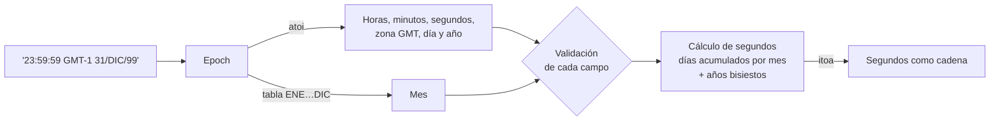

<div align="center">

# Rutinas MIPS: de la FPU al pipeline

**Subrutinas en ensamblador MIPS32 que resuelven raíces en coma flotante, convierten entre enteros y cadenas, se optimizan para el pipeline y calculan tiempo epoch**


<sub>Arquitectura y Organización de Computadores · Grado en Ingeniería Informática · Universidad de Valladolid · Curso 2022-2023</sub>

</div>



## En pocas palabras

- **Reto:** programar directamente sobre la arquitectura MIPS, desde la FPU hasta la planificación de instrucciones para un pipeline con y sin *forwarding*.
- **Solución:** una colección de subrutinas reutilizables (`RegulaFalsi`, `itoa`, `atoi`, `MatMul`, `vecMaxMin`, `Epoch`) que respetan el convenio de llamada.
- **Demuestra:** programación a bajo nivel, conocimiento de la microarquitectura, optimización de rendimiento y tratamiento riguroso de casos límite.

## Lo más destacado

- **Optimización para el pipeline:** las versiones de la práctica 5 reordenan instrucciones y sustituyen saltos condicionales por `slt` para reducir riesgos de datos y de control, en dos escenarios (`forward.xml` y `stall.xml`).
- **Comprobación automática:** `main.asm` verifica `MatMul` contra un resultado conocido e imprime `Resultado Correcto` en el MARS incluido.
- **Conversión de fechas a epoch** con validación de cada campo, años bisiestos (incluido el caso especial de 2100) y reutilización de `atoi` e `itoa`.
- **`atoi` robusto:** ignora espacios iniciales, acepta `+` y `-`, detecta caracteres no válidos y solo comprueba el desbordamiento cuando el valor se acerca al límite (`>= 0x0ccccccd`).
- **`itoa` con casos límite:** binario natural o complemento a 2 en 8, 16 o 32 bits; −2³¹ se trata aparte porque su opuesto no cabe en 32 bits.
- **Método de la falsa posición en la FPU** (`RegulaFalsi`) con control de errores de tolerancia.

## Competencias

| Área | Qué se aplicó |
|------|---------------|
| Ensamblador MIPS32 | Subrutinas, pila, convenio de llamada, FPU (coprocesador 1) |
| Microarquitectura | Riesgos de datos y de control, *forwarding*, planificación de instrucciones |
| Algoritmia numérica | Método de la falsa posición en coma flotante |
| Casos límite | Desbordamiento, −2³¹, validación de entradas, años bisiestos |

## Qué hace

- **Prácticas 1 y 2:** subrutina `RegulaFalsi`, que busca raíces por el método de la falsa posición con la FPU (`$f12`–`$f14`: tolerancia e intervalo `[a, b]`).
- **Práctica 3:** `itoa` convierte un entero en cadena en binario natural o complemento a 2, con 8, 16 o 32 bits según `$a1`.
- **Práctica 4:** `atoi` convierte una cadena en entero.
- **Práctica 5:** producto de matrices (`MatMul`) y máximo y mínimo de un vector (`vecMaxMin`), con variantes para un pipeline con *forwarding* y sin él (*stall*). `main.asm` las comprueba contra un resultado conocido.
- **Trabajo final:** subrutina `Epoch`, que recibe una fecha con el formato `HH:MM:SS GMT±N DD/MES/AA` (por ejemplo `23:59:59 GMT-1 31/DIC/99`) y devuelve como cadena los segundos transcurridos.

## Arquitectura

- **Convenio de llamada:** las subrutinas guardan en la pila los registros `$s*`, `$f20`–`$f26` y `$ra` que usan, y los restauran al salir.
- **Escenarios de pipeline:** `forward.xml` (con *forwarding*, saltos en ID) y `stall.xml` (sin *forwarding*, saltos en MEM).
- La memoria de la práctica 5 está en [`Practica5/g105_Practica5.pdf`](Practica5/g105_Practica5.pdf).

## Estructura del repositorio

```
AOC/
├── Practica1/      # RegulaFalsi (versiones de trabajo y entregadas)
├── Practica2/      # RegulaFalsi revisada
├── Practica3/      # itoa
├── Practica4/      # atoi
├── Practica5/      # MatMul y vecMaxMin para pipeline, main.asm de prueba,
│                   # forward.xml / stall.xml, MARS-F.jar y memoria en PDF
└── TrabajoFinal/   # Epoch, versiones de prueba y depuración
```

Los ficheros con nombre numérico (por ejemplo `05876.asm`) son las versiones enviadas al corrector automático de la asignatura. Los `.bat` son los scripts de Windows que se usaban para enviarlas. Leen el usuario y la clave del corrector de las variables de entorno `AOC_USER` y `AOC_PASS`.

## Requisitos

- Java, para ejecutar el simulador MARS (`Practica5/MARS-F.jar`)

## Cómo ejecutarlo

La comprobación de la práctica 5 une `main.asm` con la rutina. Los ficheros usan finales de línea antiguos (CR), así que conviene normalizarlos antes de unirlos:

<details>
<summary>Ejecutar la comprobación de la práctica 5</summary>

```bash
cd Practica5
(tr '\r' '\n' < main.asm; echo; tr -d '\r' < p5-matrixFORW.asm) > /tmp/p5.asm
java -jar MARS-F.jar nc sm /tmp/p5.asm
# Resultado Correcto
```

</details>

Este comando se ha probado en Linux. El resto de las subrutinas pueden abrirse en la interfaz gráfica de MARS (`java -jar MARS-F.jar`) junto con un programa principal propio.

## Estado y limitaciones

- Casi todos los ficheros contienen solo una subrutina, sin programa principal. El `main` que las llamaba lo aportaba el corrector de la asignatura y no está en el repositorio, así que solo la práctica 5 se ejecuta tal cual.

## Autoría

Todos los commits son de Javier García (JavivuG).

---

<div align="center"><sub>Parte de <a href="https://github.com/JavivuG/UVa-Projects">UVa-Projects</a> · Javier García González</sub></div>
